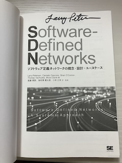

ご存知の通り，AI が信じられないスピードで進化してますよね。かたや人間の進化って，ゆったりですよね。
個人的には，それぞれのペースでいいと思っています。
と言いながら，最新の技術的な流れは把握したくて，いろいろと調べたり，試したりしています。

人と人の会話から得られる知識が大切と感じているので，ONIC のような組織や技術の壁を越えて，直接議論する場を実行委員のみんなで企画しています。
間接的に人と会話し，知識を得ていく機会の一つは書籍を読むことで，体系的に推敲を重ねた書籍は知識を得るためには，とてもよいと考えています。

ちなみに，学生のころの読書感想文の宿題は，本のまえがきと，あとがきを読んで，それぞれをほぼ丸写しで提出していましたが，家人のお勧めで東野圭吾さんの”天空の蜂”を読んだことがきっかけで，本を読むようになりました。

では，何を読めばいいのか。。。書店に行くと，どうしてもト◯レに行きたくなる。
立ち読みは足腰が痛くなる。
等々，個人的には本選び得意じゃないです。
娯楽向けには直木賞等の受賞作品を読み，技術書やビジネス書は信頼できる周囲の読書家が勧める書籍を読んでいます。

そして，書籍選びで一番良いと思っているのが，知人が書いた書籍を読むことです。
知人が書いた書籍を読むと，読了後に書いた本人に”ここ教えて，どういう背景があるの？”と聞くことができるので，得難い機会です。

実行委員として活動させていただく中，実行委員のみんなや講演者の方々との会話から，たくさんのことを教えていただいています。
この教えていただくことを文書化することは難しいのですが，今年は企画運営の活動を通して複数の書籍に出会いました。
実行委員や講演者から紹介された書籍です。
書籍選びで迷った際に使う，最も確実で有用な方法で書籍にたどり着きました。

教えていただいた書籍をネタバレしないように紹介してみます。

### AIインフラに求められるネットワーク

今のお仕事のメインはKubernetes 関連ですので，ネットワークシステムに直接関わる時間がめっきり減っています。
過去のつながりでInterop Tokyo ShowNet 関係者とは会話しますが，ディープなネットワーク議論まで至っておらず，飲み会が中心になっています。。。
そこで，紹介いただいたのが，実行委員の鎌田さんが執筆された[書籍](https://amzn.asia/d/02dpkrrn)です。

読み始めから，非常に衝撃的でした。
これまでWeb やストリーミングのトラフィックをネットワーク視点のみで，最適な転送・ルーティングするかを意識し，設計/構築/運用に落とし込んでいましたが，AI がネットワークに求める要件が大きく変化していることを知ることができました。
改めて，アプリケーションやサービスあってのネットワークであり，ネットワークあってのアプリケーションやサービスだなーと，感じた一冊です。

### 量子コンピュータ関連

量子コンピュータの中身が分かっていないので，理解しようとすると，挫折する。
これを繰り返してきました。
なんとか打開したいなーと思い続けて，数年が経ちました。。。
今年講演いただく山下さんと[本会議](https://www.onic.jp/program-detail/#s_01)・[BoF](https://www.onic.jp/program-detail/#b_03)でのそれぞれの講演内容について事前にお話し，量子コンピュータを理解するためには，量子力学を知る必要があることを教えていただきました。
併せて推薦図書も紹介いただきました。

紹介いただいた一冊目は，[基礎から鍛える量子力学](https://amzn.asia/d/02LqZL0M)です。
この書籍では，手を動かして，微分積分や行列を計算するので，読む速度が上がりません。
現在，絶賛読み進めています。
まだ途中ですが，なるほど感じたポイントがいくつかありました。
* これまで中高で習ってきた物理(古典物理)と量子力学の間にはギャップがあるので，想像できない側面が多い。
* 古典物理は日常生活を五感で体験することを説明できる。一方，ミクロ領域では自然現象で説明できない場面がある。

ゆっくり読み進めていこうと思います。

もう一冊は，[光の量子コンピュータ](https://amzn.asia/d/061STXIS)です。
こちらは新書なので，ページ数は多くなく，読み進めやすいかと思います。
この書籍の中で，"おお"と思ったのが，量子テレポーテーションの説明です。
その説明内で，私たちが日常利用しているIT システムと比較しています。
とても納得感がありました。

### ネットワークシステムについて語るときに我々の語ること

こちらは実行委員の進藤さんが翻訳した書籍です。
この書籍は，非常に示唆に富んでいる[エッセイ集](https://amzn.asia/d/0irym544)です。

示唆に富んでいる理由は，数多くの論文や書籍，ネット記事の引用があるからだと，感じています。
つまり，引用されたモノの内容を確認すれば，より深く理解できるはずで，個人的には少しずつではありますが，確認を進めています。

あくまでも個人的に調べているのであって，必須ではないです。
書籍だけでも十分理解できますので，これまでのネットワークシステムを知りたい方や，今後のネットワークシステムの未来を予測したい方には，とても有用な書籍です。

本来，実行委員が投稿する開催直前ブログでは，今年の聞き処を紹介することが，常套なのかもしれませんが，紹介しません，[各サマリー](https://www.onic.jp/program/)を読んでください(爆)。
なお，イラストはAI に描いてもらったので，信憑性の保証はないです。あらかじめご理解ください。

ONIC実行委員 金海 好彦

###### 追伸

2022年のONIC では，[Software-Defined Networks ソフトウェア定義ネットワークの概念・設計・ユースケース](https://amzn.asia/d/021JRr78)の著者の一人であるラリーさんに[講演](https://www.onic.jp/archives/2022/program-detail/#s_10)いただき，直筆のサインもいただきました。

